# ⌚ Wearable Health and Fall Detection IoT System

 A wearable IoT prototype for health and environmental monitoring, fall detection, emergency SMS alerts, and MQTT-based data transmission.


## 📌 Overview

This project is a wearable health-monitoring and fall-detection system built around the **Silicon Labs BRD2608A**.

The system collects health, environmental, and motion data from multiple sensors. The BRD2608A processes the sensor data and controls the local OLED display and buzzer.

The **A7680C cellular module** provides:

* Emergency SMS notifications
* Approximate location using Cell-ID
* MQTT communication for IoT data transmission

The project is developed as a research and development prototype for wearable health monitoring and emergency fall detection.

---

## 🎥 Demo

### Hardware Prototype

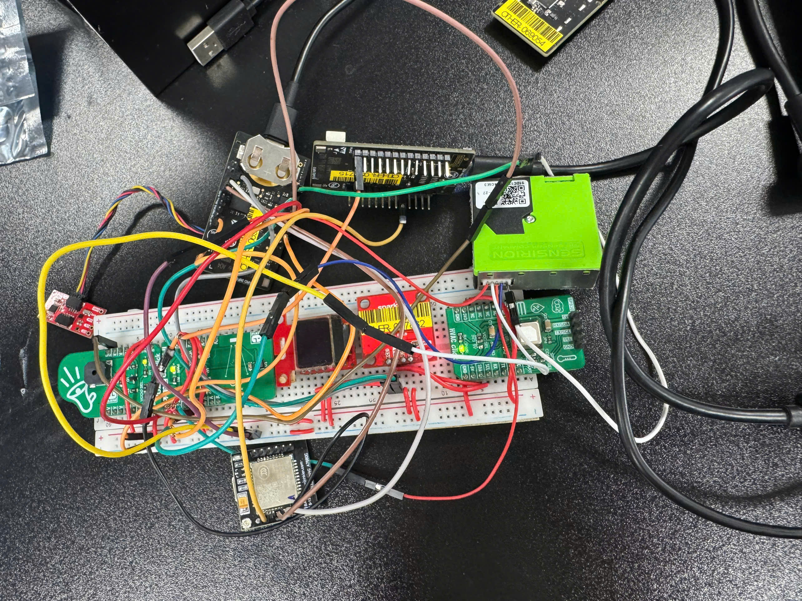

### OLED — Normal Monitoring

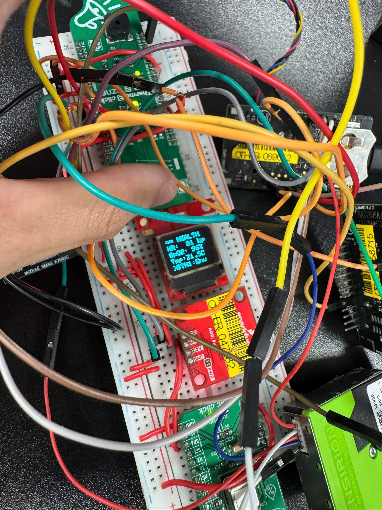
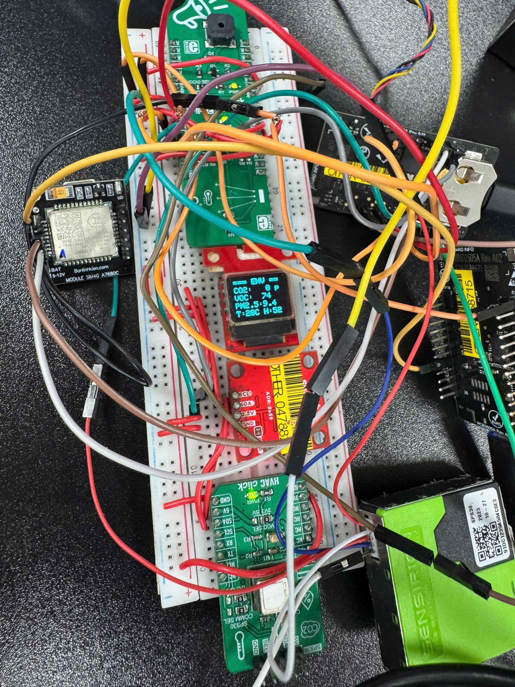
### OLED — Fall Detection


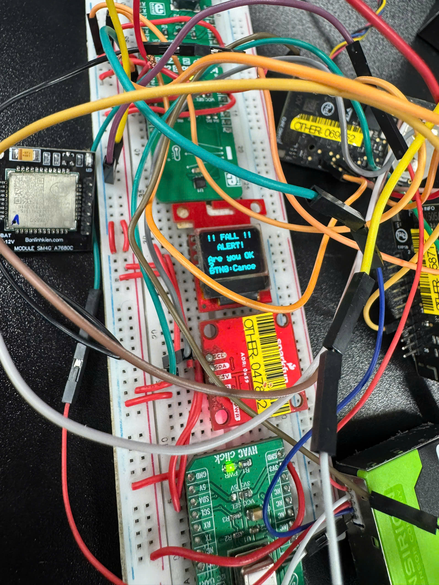

### IoT MQTT Panel


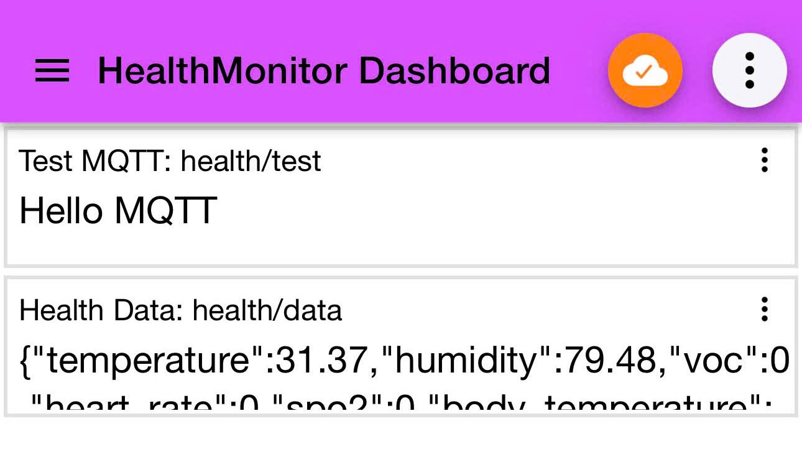

### Emergency SMS


## ✨ Features

* ❤️ Heart rate monitoring
* 🩸 SpO₂ monitoring
* 🌡️ Temperature and humidity monitoring
* 🌫️ VOC air-quality monitoring
* 🫁 CO₂ monitoring
* 💨 PM2.5 monitoring
* 🌡️ Non-contact temperature measurement
* 🏃 IMU-based fall detection
* 🖥️ OLED local display
* 🔊 Emergency buzzer
* 📱 Emergency SMS notification
* 📍 Approximate Cell-ID location
* 📡 MQTT communication
* 📊 IoT MQTT Panel monitoring

---

## 🏗️ System Architecture

```text
                    ┌──────────────────┐
                    │     Sensors      │
                    │                  │
                    │ MAX30101         │
                    │ Si7021           │
                    │ SGP40            │
                    │ MLX90632         │
                    │ SCD41            │
                    │ SPS30            │
                    │ ICM40627         │
                    └────────┬─────────┘
                             │
                             ▼
                    ┌──────────────────┐
                    │    BRD2608A      │
                    │ Main Controller  │
                    │                  │
                    │ Sensor Processing│
                    │ Fall Detection   │
                    │ OLED Control     │
                    │ Buzzer Control   │
                    └──────┬─────┬─────┘
                           │     │
                           │     │
                    ┌──────┘     └────────┐
                    ▼                      ▼
              ┌───────────┐        ┌─────────────┐
              │OLED/Buzzer│        │   A7680C    │
              └───────────┘        │  Cellular   │
                                   └──────┬──────┘
                                          │
                              ┌───────────┴───────────┐
                              │                       │
                             SMS                     MQTT
                              │                       │
                              ▼                       ▼
                       Emergency Contact       MQTT Broker
                                                      │
                                                      ▼
                                               IoT MQTT Panel
```

---

## 🔧 Hardware

| Component    | Function                             |
| ------------ | ------------------------------------ |
| **BRD2608A** | Main controller                      |
| **A7680C**   | Cellular communication, SMS and MQTT |
| **MAX30101** | Heart rate and SpO₂                  |
| **Si7021**   | Temperature and humidity             |
| **SGP40**    | VOC measurement                      |
| **MLX90632** | Non-contact temperature              |
| **SCD41**    | CO₂ measurement                      |
| **SPS30**    | PM2.5 measurement                    |
| **ICM40627** | Motion and fall detection            |
| **OLED**     | Local data display                   |
| **Buzzer**   | Emergency alarm                      |

---

## 🔄 How It Works

### 1. Sensor Monitoring

The sensors collect health, environmental, and motion data.

The BRD2608A processes the measurements and updates the OLED display.

The integrated sensors include:

* MAX30101 — heart rate and SpO₂
* Si7021 — temperature and humidity
* SGP40 — VOC
* MLX90632 — non-contact temperature
* SCD41 — CO₂
* SPS30 — PM2.5
* ICM40627 — motion and fall detection

---

### 2. Fall Detection

The ICM40627 monitors the user's movement.

The current prototype follows this sequence:

```text
Free-fall detected
       ↓
Impact detected
       ↓
Fall confirmed
       ↓
5-second recovery countdown
       ↓
User recovers?
    ↙       ↘
  YES        NO
   ↓          ↓
 Reset      Emergency
            Alert
```

If the user does not recover during the 5-second countdown, the emergency procedure is started.

---

### 3. Emergency Alert

After a confirmed fall:

1. The BRD2608A starts the emergency procedure.
2. The A7680C obtains an approximate location using Cell-ID.
3. The firmware generates a Google Maps location link.
4. An emergency SMS is sent to the configured contact.


---

### 4. MQTT Communication

The A7680C provides cellular MQTT connectivity for IoT data transmission.

The current prototype uses:

```text
Broker: broker.hivemq.com
Port:   1883
```

Basic MQTT connection and test publishing have been successfully verified.

The complete health-data MQTT publishing path is still being debugged.

---

## 📡 MQTT

### MQTT Test

The basic MQTT connection has been successfully tested using:

```text
Topic:
health/test

Payload:
Hello MQTT
```

Data flow:

```text
BRD2608A
    │
    ▼
A7680C
    │
    ▼
broker.hivemq.com:1883
    │
    ▼
health/test
```

---

### Health Data

The firmware generates health and environmental data as JSON.

Example payload generated during testing:

```json
{
  "temperature": 31.44,
  "humidity": 77.62,
  "voc": 74,
  "heart_rate": 81,
  "spo2": 96,
  "body_temperature": 30.45,
  "co2": 569,
  "pm2_5": 15.56,
  "fall": 0
}
```

Health data topic:

```text
health/data
```


### MQTT Status

```text
MQTT connection
      │
      ├── health/test + Hello MQTT     ✅ Working
      │
      └── health/data + JSON           ⚠️ Debugging
```

---

## 🚀 Getting Started

### Requirements

#### Hardware

* Silicon Labs BRD2608A
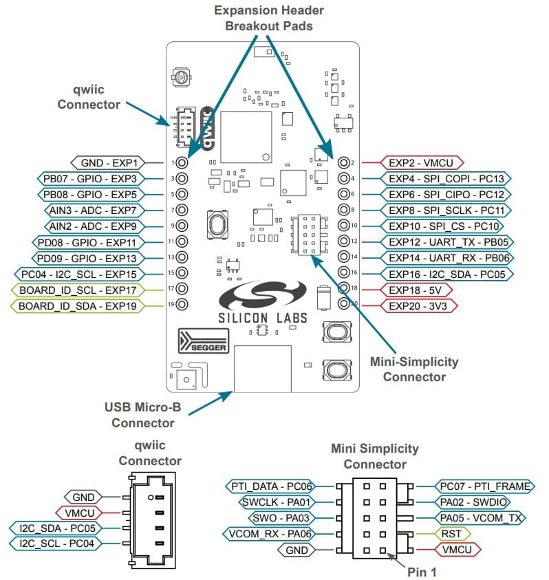
* A7680C cellular module
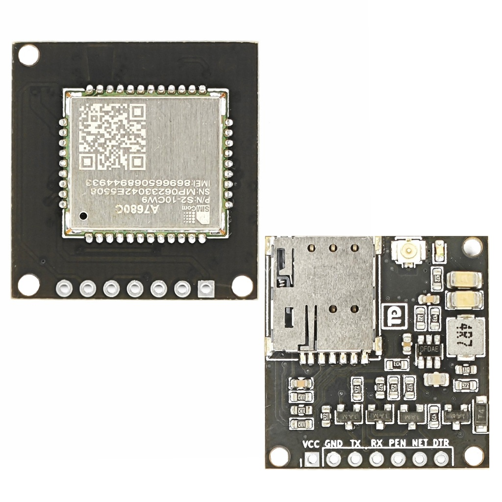

* SIM card with cellular/data service(sim4g thông thường)
* MAX30101
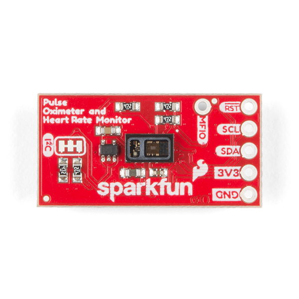
* SGP40
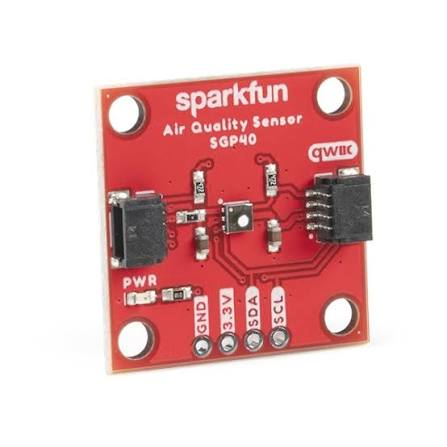
* MLX90632
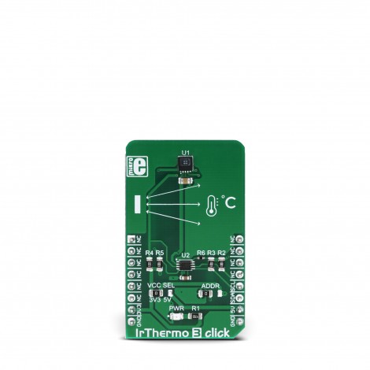
* SCD41
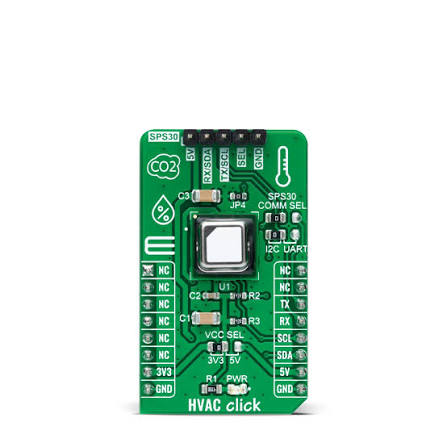
* SPS30
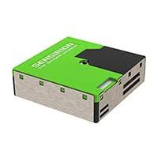
* OLED display
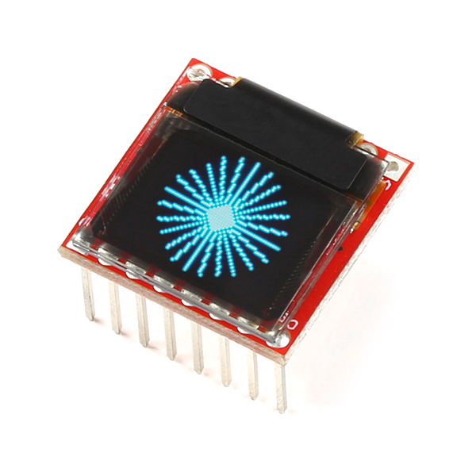
* Buzzer
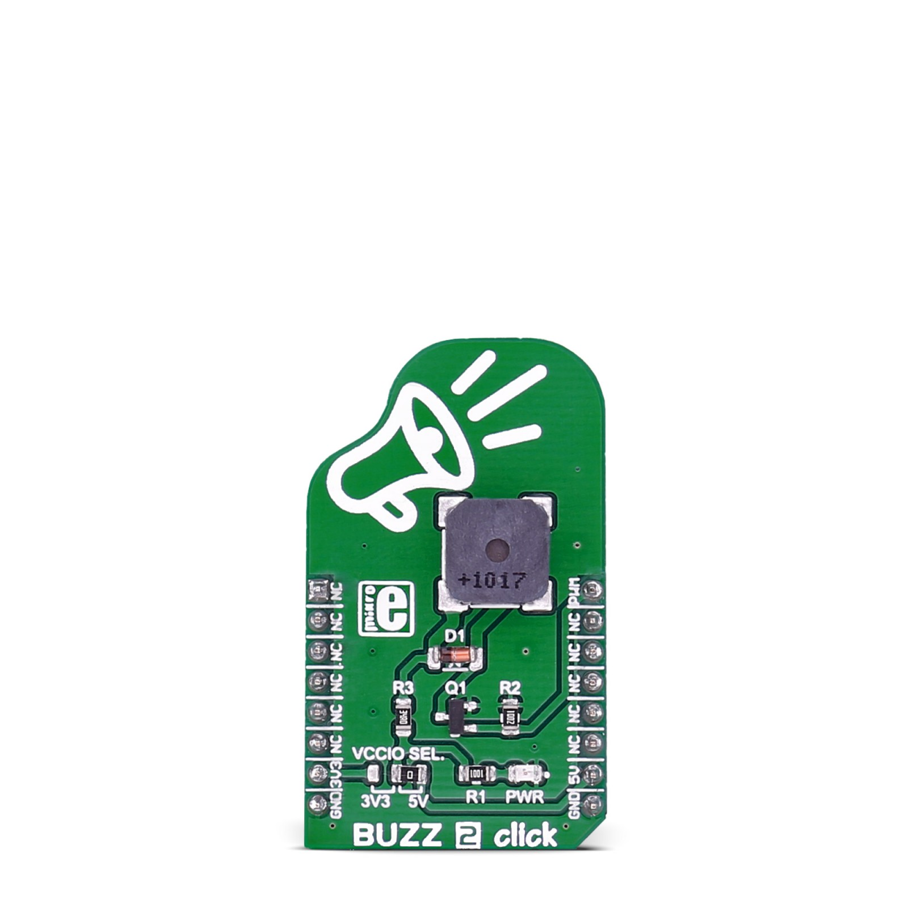


#### Software

* Silicon Labs Simplicity Studio
* Silicon Labs SDK 2025.6.3
* Serial terminal
* IoT MQTT Panel

---

## ⚙️ Build and Flash

### 1. Open the Project

Open the firmware project in **Simplicity Studio**.

### 2. Configure the Emergency Number

Set the emergency phone number used by the A7680C.

Do not commit a real phone number to a public repository.

Example:

```c
#define EMERGENCY_PHONE "+84XXXXXXXXX"
```

### 3. Build

Build the firmware project:

```text
Build Project
```

### 4. Flash

Flash the firmware to the BRD2608A.

### 5. Monitor the Device

Open a serial terminal and reset the device.

The startup log should show initialization of:

* OLED
* Si7021
* SGP40
* MAX30101
* MLX90632
* SCD41
* SPS30
* ICM40627
* A7680C

---
=== [FINAL] All Sensors + OLED + Fall Detection ===
[A7680C] Che do: GUI SMS THAT.
[OLED] Init Successfully!
[OLED] Init OK
[RHT] PC09 state = 1 (phai = 1)
[RHT] sl_si70xx_present = 1 | device_id = 0x15 (Si7021 phai = 0x15)
Si7021 init OK!
[SGP40] I2C init OK.
[SGP40] measure_test raw result = 0xD400 (expect 0xD400 = PASSED, 0x4B00 = FAILED)
[SGP40] Self-test PASSED.
[SGP40] Heater off OK.
[SGP40] VOC algorithm init OK.
[SGP40] Init hoan tat thanh cong!
[SGP40] Init OK!
bio_hub_init ret=0x0
bio_hub_config_bpm ret=0x0
set_pulse_width ret=0x0
set_sample_rate ret=0x0
Load buffer....
MAX30101 init OK!
[MAX30101] Init OK!
MLX90632 init OK!
[MLX90632] Init OK!
SCD41 Serial Number: 21259-64263-15171
SCD41 periodic measurement started!
[SCD41] Init OK!
[SPS30] I2C init OK.
[SPS30] Probed successfully!
[SPS30] FW Version: 2.3
[SPS30] Serial: 91DC1239A584C6E3
[SPS30] Measurement started successfully!
[SPS30] Init OK!
ICM40627 Fall Detection Init OK!
[FALL] Init OK!
[A7680C] Dang init module...
[A7680C] Initializing...
[A7680C] Flush URC sau boot...
[A7680C] [1/7] Kiem tra AT (thu toi da 5 lan)...
[A7680C] AT lan thu 1...
[A7680C] CMD: AT
[A7680C] Response: AT
OK
[A7680C] [OK] Tim thay: "OK"
[A7680C] [2/7] Tat echo (ATE0)...
[A7680C] CMD: ATE0
[A7680C] Response: ATE0
OK

+CGEV: EPS PDN ACT 1

+CGEV: ME PDN ACT 8,0

[A7680C] [3/7] Kiem tra SIM (AT+CPIN?)...
[A7680C] CPIN lan thu 1...
[A7680C] CMD: AT+CPIN?
[A7680C] Response: 
+CPIN: READY
[A7680C] [OK] Tim thay: "READY"
[A7680C] [4/7] Kiem tra tin hieu (AT+CSQ)...
[A7680C] CMD: AT+CSQ
[A7680C] Response: 
+CSQ:
[A7680C] [OK] Tim thay: "+CSQ:"
[A7680C] [5-6/7] Kiem tra mang (thu toi da 10 lan)...
[A7680C] Kiem tra mang lan thu 1...
[A7680C] CMD: AT+CREG?
[A7680C] Response: 
+CREG: 0,1

OK

[A7680C] CREG: [OK] Da dang ky
[A7680C] CMD: AT+CEREG?
[A7680C] Response: 
+CEREG: 0,1

OK

[A7680C] CEREG: [OK] Da dang ky
[A7680C] [7/7] Kiem tra nha mang (AT+COPS?)...
[A7680C] CMD: AT+COPS?
[A7680C] Response: 
+COPS:
[A7680C] [OK] Tim thay: "+COPS:"
[A7680C] Dat che do SMS text (AT+CMGF=1)...
[A7680C] CMD: AT+CMGF=1
[A7680C] Response: 
OK
[A7680C] [OK] Tim thay: "OK"
[A7680C] Dat bo ma GSM (AT+CSCS)...
[A7680C] CMD: AT+CSCS="GSM"
[A7680C] Response: 
OK
[A7680C] [OK] Tim thay: "OK"
[A7680C] Xoa toan bo SMS trong SIM (AT+CMGD=1,4)...
[A7680C] CMD: AT+CMGD=1,4
[A7680C] Response: 
OK
[A7680C] [OK] Tim thay: "OK"
[A7680C] [OK] Xoa SMS thanh cong
[A7680C] Init OK!
[A7680C] Init OK! Module va mang san sang.
[MQTT] Bat dau test MQTT...

========================================
 A7680C MQTT TEST
 HiveMQ
========================================
[MQTT] Checking packet domain attach...
[A7680C] CMD: AT+CGATT=1
[A7680C] Response: 
OK
[A7680C] [OK] Tim thay: "OK"

[A7680C][MQTT] Start MQTT service...
[A7680C] CMD: AT+CMQTTSTART
[A7680C] Response: 
OK

+CMQTTSTART: 0
[A7680C] [OK] Tim thay: "+CMQTTSTART: 0"
[A7680C][MQTT] MQTT service STARTED
[A7680C][MQTT] Acquire MQTT client...
[A7680C] CMD: AT+CMQTTACCQ=0,"BRD2608A_HealthMonitor_001",0
[A7680C] Response: 
OK
[A7680C] [OK] Tim thay: "OK"
[A7680C][MQTT] Client acquired
[A7680C][MQTT] Connect HiveMQ...
[A7680C] CMD: AT+CMQTTCONNECT=0,"tcp://broker.hivemq.com:1883",60,0
[A7680C] Response: 
OK

+CMQTTCONNECT: 0,0
[A7680C] [OK] Tim thay: "+CMQTTCONNECT: 0,0"
[A7680C][MQTT] CONNECTED TO HiveMQ
[A7680C][MQTT] Topic: health/test
[A7680C] CMD: AT+CMQTTTOPIC=0,11
[A7680C] Response: 
>
[A7680C] [OK] Tim thay: ">"
[A7680C][MQTT] Payload: Hello MQTT
[A7680C] CMD: AT+CMQTTPAYLOAD=0,10
[A7680C] Response: 
>
[A7680C] [OK] Tim thay: ">"
[A7680C] CMD: AT+CMQTTPUB=0,0,60
[A7680C] Response: 
OK

+CMQTTPUB: 0,0
[A7680C] [OK] Tim thay: "+CMQTTPUB: 0,0"
[A7680C][MQTT] PUBLISH SUCCESS

========================================
 MQTT TEST SUCCESS
 Broker : broker.hivemq.com
 Port   : 1883
 Topic  : health/test
 Data   : Hello MQTT
========================================
[MQTT] TEST THANH CONG!
[BUZZER] Init OK
=== Init done ===

## 🧪 Current Test Results

| Function                 | Status                        |
| ------------------------ | ----------------------------- |
| BRD2608A firmware        | ✅ Working                     |
| OLED display             | ✅ Working                     |
| Si7021                   | ✅ Working                     |
| SGP40                    | ✅ Working                     |
| MAX30101                 | ✅ Working                     |
| MLX90632                 | ✅ Working                     |
| SCD41                    | ✅ Working                     |
| SPS30                    | ✅ Working                     |
| ICM40627                 | ✅ Fall detection demonstrated |
| Buzzer                   | ✅ Working                     |
| A7680C initialization    | ✅ Working                     |
| Cellular registration    | ✅ Working                     |
| Cell-ID location         | ✅ Working                     |
| Emergency SMS            | ✅ Working                     |
| MQTT connection          | ✅ Working                     |
| Basic MQTT publish       | ✅ Working                     |
| Health JSON generation   | ✅ Working                     |
| Health JSON MQTT publish | ⚠️ Debugging                  |
| Android application      | 🚧 Planned / In development   |
| Custom PCB               | 🚧 Planned                    |

---

## 📂 Project Structure

```text
Wearable-Health-Fall-Detection/
│
├── firmware/
│   ├── src/
│   ├── app.c
│   └── ...
│
├── images/
│   └── demo/
│       ├── full_hardware.jpg
│       ├── oled_normal.jpg
│       ├── oled_fall.jpg
│       ├── mqtt_panel.jpg
│       └── emergency_sms.jpg
│
├── docs/
│   ├── sensors.md
│   ├── mqtt.md
│   ├── fall_detection.md
│   └── pcb.md
│
└── README.md
```

---

## 🛠️ Future Development

* [ ] Stabilize health JSON MQTT publishing
* [ ] Add MQTT reconnect and retry mechanisms
* [ ] Improve fall-detection reliability
* [ ] Add sensor data history
* [ ] Develop Android companion application
* [ ] Add real-time health monitoring on Android
* [ ] Add emergency notifications on Android
* [ ] Optimize power consumption
* [ ] Design custom PCB
* [ ] Build a compact wearable enclosure

---

## 👨‍💻 Author

**Wearable Health and Fall Detection IoT System**

Built with:

* Silicon Labs BRD2608A
* A7680C
* Embedded C
* MQTT
* IoT MQTT Panel
* Health and environmental sensors
